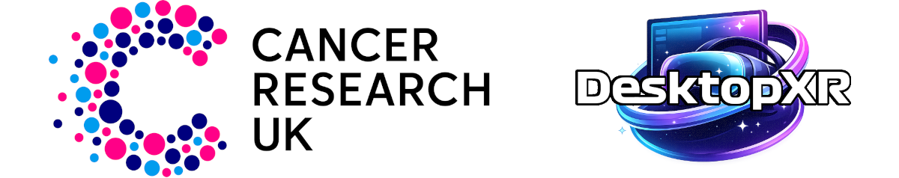
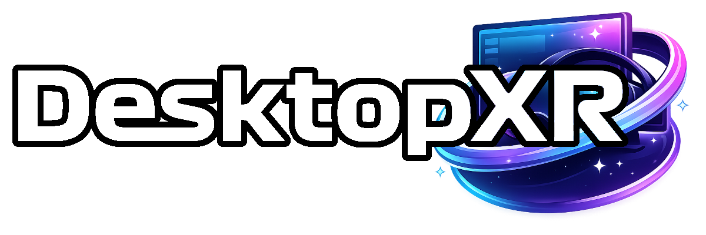

  ALL SPONSORSHIPS GO TO CANCER RESEARCH UK - <a href="sponsorships/README.md">READ MORE</a>
   

---

  
   Compatible with all OpenXR VR Headsets
   Launched 15th February 2026

### 1st November (Early Access)
### 1st December (General Release)

 
 See the new configurator <a href="images/configurator-190.png">here</a>
 

### DesktopXR v1.9.0 Release Notes

#### FocusCore Gen2 - Foveated Rendering
- **Intelligent render tracking.** The new render-lineage system learns how your game renders each eye in real time, automatically applying variable rate shading (VRS) to compatible workloads while respecting the shader exclusions defined in the game’s profile.
- **Improved eye tracking.** Refined OpenXR eye-tracking support, with horizontal and vertical offsets to fine-tune gaze alignment, particularly useful for headsets such as the Bigscreen Beyond 2e.

#### MotionCore - Adaptive Frame Generation
- **Intelligent adaptive frame generation.** Automatically monitors GPU frame times and activates when the GPU can no longer maintain consistent performance, helping deliver a smoother, more stable VR experience.
- **2× and 3× frame generation.** Generates additional frames between rendered frames to improve perceived smoothness and help maintain your headset's target refresh rate during demanding scenes.
- **GPU and runtime compatibility.** Requires an NVIDIA graphics card. MotionCore has been tested with the SteamVR and Pimax OpenXR runtimes.

#### VisionCore - Image Post-Processing
- **Auto Tune.** Automatically adjusts VisionCore’s full set of colour and tonal controls at the press of a button, including the new shadows, blacks, temperature, tint and vibrance settings.
- **8K helmet mask.** A high-resolution helmet mask with a realistic sunshade effect.
- **VRS Pixel Smoothing.** Helps reduce visible pixelation from variable rate shading for a cleaner, smoother image.

#### Desktop Overlay
- **HDR to SDR tone mapping.** View HDR desktop content in VR without washed-out colours or blown-out highlights.
- **Multi-monitor overlay.** Display single, dual or triple screens in VR.

#### Benchmarking
- **Improved performance reports.** Reports now visualise GPU frame times against your VR headset’s target frame time, making it easier to see when GPU rendering stays within, or exceeds, the time available for each frame.

### Companion
- **Hand-off & Recall.** Launch a game from the Companion and automatically return to your desktop when you exit, making it easier to move between your desktop and VR games.

### Configurator
- **Real-time configuration.** Most settings including FocusCore, VisionCore, transparency, heads up display and multi-monitor controls now take effect immediately in DesktopXR as you adjust them in the Configurator, without needing to save or restart.
- **Built-in warning system.** Automatically checks for common issues and alerts you when something needs attention.
- **Quick access to configuration and files.** Easily access INI configuration files, temporary files and relevant folders from within the Configurator.
- **Update notifications.** Get notified when a newer version is available.

### DataBridge
- **Improved web-renderer diagnostics.** Enhanced error logging for the CEF Web Renderer makes it easier to investigate web-rendering issues.
- **In-session performance metrics.** Switch CPU and GPU readings between usage percentages and frame times without leaving your VR session.

 

Benchmarks v1.9.0 FINAL
 <a href="https://htmlpreview.github.io/?https://github.com/glenimp617/DesktopXR/blob/main/benchmarks/AssettoCorsaEVO-v190.htm">Assetto Corsa Evo (MSAA2)</a>
 <a href="https://htmlpreview.github.io/?https://github.com/glenimp617/DesktopXR/blob/main/benchmarks/Automobilista2-v190.htm">Automobilista 2 (MSAA2)</a>
 <a href="https://htmlpreview.github.io/?https://github.com/glenimp617/DesktopXR/blob/main/benchmarks/EliteDangerous-v190.htm">Elite Dangerous (SMAA)</a>
 <a href="https://htmlpreview.github.io/?https://github.com/glenimp617/DesktopXR/blob/main/benchmarks/Le_Mans_Ultimate-v190.htm">Le Mans Ultimate (MSAA2)</a>
 <a href="https://htmlpreview.github.io/?https://github.com/glenimp617/DesktopXR/blob/main/benchmarks/FlightSimulator_2020-v190.htm">Microsoft Flight Simulator 2020 (TAA High)</a>
 <a href="https://htmlpreview.github.io/?https://github.com/glenimp617/DesktopXR/blob/main/benchmarks/FlightSimulator_2024-v190.htm">Microsoft Flight Simulator 2024 (DLSS Ultra)</a>
 <a href="https://htmlpreview.github.io/?https://github.com/glenimp617/DesktopXR/blob/main/benchmarks/starwarssquadrons-v190.htm">Star Wars Squadrons (TAA Ultra)</a>

---

# DesktopXR

DesktopXR is an advanced OpenXR API layer designed to enhance VR performance, visual quality and usability. Powered by FocusCore, MotionCore and VisionCore, it combines intelligent fixed and eye-tracked foveated rendering, adaptive frame generation and advanced image processing with fully integrated desktop and web overlays, heads-up displays and performance benchmarking tools.

This app will always remain free 🙂

Trailer 2 - https://youtu.be/iK55JJQ0_6M
 Trailer 1 - https://youtu.be/vDwvvHKjbJM

## Features

- OpenXR API layer
- DirectX 11 & 12 rendering
- **FocusCore** - Fixed and eye-tracked foveated rendering
- **MotionCore** - Adaptive 2× and 3× frame generation (NVIDIA GPU)
- **VisionCore** - Advanced image processing
- FOV cropping
- Desktop overlay with multi-monitor support
- HDR to SDR tone mapping
- Customisable heads-up display
- Web overlays
- GPU performance benchmarking
- Minimal performance overhead
- Simple MSI installer
- Clean uninstall support
- No additional software to install
- SSL.com malware scanned and digitally signed binaries

---

## Installation

1. Download the latest `.msi` from the Releases page
2. Run the installer
3. Restart any running OpenXR applications

The API layer will automatically register with the system.

---

## Uninstall

Use standard Windows uninstall:

Settings → Apps → Installed Apps → DesktopXR → Uninstall

or

Control Panel → Programs and Features

---

## Configuration

DesktopXR can be configured via a simple settings file.

To change the overlay toggle key and other options,
see the full documentation:

📖 https://github.com/glenimp617/desktopxr/wiki

---

## Compatibility

- Windows 10 / Windows 11
- OpenXR compatible runtimes
- DirectX 11 capable GPU

---

## Known Limitations

- Tested on standard desktop OpenXR runtimes
- Behavior may vary across headset vendors

---

## License

DesktopXR is distributed as a binary under a proprietary license. See `LICENSE.txt` for details.

This repository and its contents are not licensed for reuse, modification, redistribution, or commercial use unless permission is granted in `LICENSE.txt` or by written agreement.

DesktopXR includes or uses third-party components, including the Khronos OpenXR SDK, NVIDIA NVAPI SDK, and Chromium Embedded Framework. These components remain under their respective licenses. See `THIRD_PARTY_NOTICES.txt` for details.

---

## Disclaimer

This software is provided as-is without warranty.
Use at your own risk.

---

## Support

Bug reports and feedback are welcome via GitHub Issues.

---

## ❤️ Sponsors

Thank you to everyone supporting DesktopXR!
 Sponsors recieve early access - email desktopxr@gmail.com for download link

<table>
  <tr>
    <td align="center">
      <a href="https://github.com/rshummel75">
         
        <b>rshummel75</b>
      </a>
    </td>
    <td align="center">
      <a href="https://github.com/phoenixMag00">
         
        <b>phoenixMag00</b>
      </a>
    </td>
    <td align="center">
      <a href="https://github.com/1650singh">
         
        <b>1650singh</b>
      </a>
    </td>
    <td align="center">
      <a href="https://github.com/Letrange-g">
         
        <b>Letrange-g</b>
      </a>
    </td>
    <td align="center">
      <a href="https://github.com/jeffgreenhut">
         
        <b>jeffgreenhut</b>
      </a>
    </td>
    <td align="center">
      <a href="https://github.com/Nokhz">
         
        <b>Nokhz</b>
      </a>
    </td>
  </tr>
  <tr>
    <td align="center">
      <a href="https://github.com/jaavib">
         
        <b>jaavib</b>
      </a>
    </td>
    <td align="center">
      <a href="https://github.com/tgeske88">
         
        <b>tgeske88</b>
      </a>
    </td>
      <td align="center">
      <a href="https://github.com/holden37141">
         
        <b>holden37141</b>
      </a>
    </td>
      <td align="center">
      <a href="https://github.com/seanhartt">
         
        <b>seanhartt</b>
      </a>
    </td>
      <td align="center">
      <a href="https://github.com/FredisaBasset">
         
        <b>FredisaBasset</b>
      </a>
    </td>
      <td align="center">
      <a href="https://github.com/acg12git">
         
        <b>acg12git</b>
      </a>
    </td>
  </tr>
</table>
